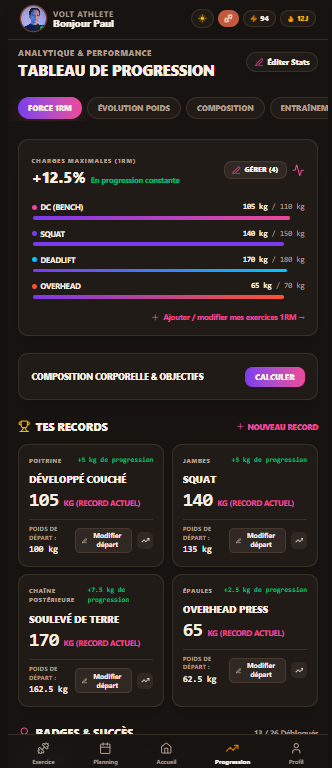
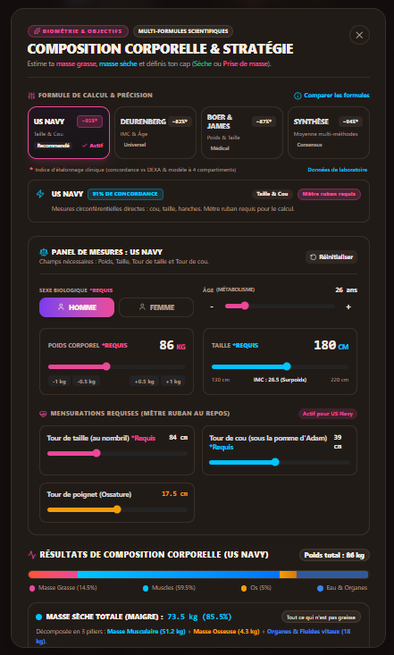
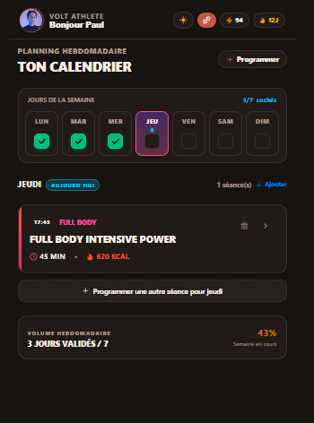

<h1 align="center">VOLT Athlete</h1>

<p align="center">
  <b>Suivi de musculation : séances, planning, progression et composition corporelle.</b><br>
  Application installable (PWA) · données stockées sur ton appareil · sans compte
</p>

<p align="center">
  
  
  
  
  
  
</p>

<p align="center">
  <a href="https://funappi.github.io/Liftrack/"><b>Ouvrir l'application</b></a>
</p>

<p align="center">
  
  &nbsp;
  
  &nbsp;
  
</p>

## Sommaire

- [Fonctionnalités](#fonctionnalités)
- [Démarrage rapide](#démarrage-rapide)
- [Scripts](#scripts)
- [Structure du projet](#structure-du-projet)
- [Données et confidentialité](#données-et-confidentialité)
- [Déploiement](#déploiement)
- [Licence](#licence)

## Fonctionnalités

- **Séances** : crée tes séances de A à Z (exercices, séries, temps de repos) et lance-les en mode entraînement en direct.
- **Planning** : calendrier hebdomadaire, programmation des séances par jour, suivi des jours validés.
- **Progression** : charges maximales (1RM), records personnels avec courbe d'évolution, poids, calories.
- **Composition corporelle** : estimation de la masse grasse et de la masse sèche, objectifs et recommandations.
- **Badges et défis** : objectifs à débloquer et challenge en cours.
- **Coach mascotte**, rappels par notification et thèmes clairs ou sombres.
- **Sauvegarde** : export et import de toutes tes données dans un fichier.
- **Hors ligne** : l'application s'installe sur le téléphone et fonctionne sans connexion.

## Démarrage rapide

Prérequis : Node.js 22.

```bash
git clone https://github.com/funappi/Liftrack.git
cd Liftrack
npm install
npm run dev
```

L'application est servie sur `http://localhost:3000/Liftrack/`.

## Scripts

| Commande | Rôle |
|---|---|
| `npm run dev` | Serveur de développement (port 3000) |
| `npm run build` | Build de production dans `dist/` |
| `npm run preview` | Aperçu du build |
| `npm run lint` | Vérification des types TypeScript |
| `npm run gen:themes` | Régénère `src/themes.css` à partir des thèmes |

## Structure du projet

```
src/
├── App.tsx            # Navigation entre les onglets
├── components/        # Écrans et modales (accueil, séances, progression, réglages…)
├── data/              # Modèle de données, contexte, migrations, sélecteurs
├── utils/             # Calculs (composition corporelle, surcharge, dates), sauvegarde, notifications
├── themes.ts          # Moteur de thèmes
└── sw.ts              # Service worker (cache hors ligne, notifications)
public/                # Icônes, images et mascottes
scripts/               # Génération du CSS des thèmes
```

## Données et confidentialité

Toutes les données restent dans le navigateur de ton appareil (stockage local). Rien n'est envoyé sur un serveur ; pense à exporter une sauvegarde avant de changer de téléphone ou de vider les données du navigateur.

## Déploiement

Chaque push sur `main` lance le workflow GitHub Actions `.github/workflows/deploy.yml`, qui construit l'application et la publie sur GitHub Pages.

## Licence

Ce projet est distribué sous la licence [PolyForm Noncommercial 1.0.0](LICENSE) : utilisation, modification et partage libres pour tout **usage non commercial**.

**Usage commercial : contacte-moi pour une licence séparée** — [Funappi](https://github.com/funappi).

Made by [Funappi](https://github.com/orgs/funappi/repositories)
